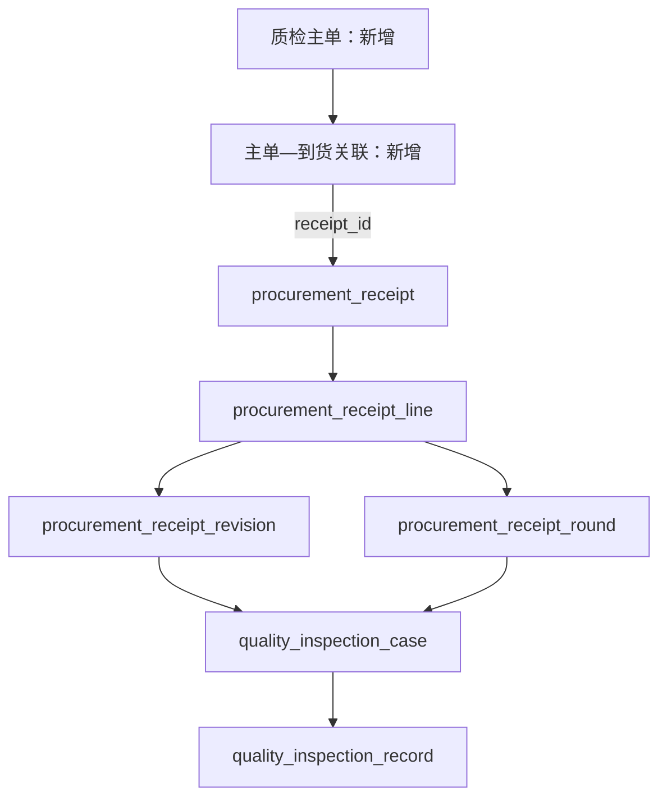

# 来料质检主单实施计划

状态：分组职责、整单关联可调整、组件复用和分层读取方案已确认，功能尚未实施。本文由 Quality 维护，是本次增量的唯一实施计划；当前检查事实仍以[检验数据库](database.md)、[到货办理](../../procurement/docs/receipts.md)和[来料交互](../../../../../admin-web/docs/incoming-inspection-adoption.md)为准。整体实施、用户验收和正式测试状态由[路线图](../../../../../../docs/roadmap.md#来料质检主单分组已确认待实施)维护。

## 1. 目标与取代范围

质检主单只负责组织完整到货单，提供稳定的质检单号和分组入口。允许跨采购、跨供应商关联；同一到货同时最多属于一张质检主单。关联按真实 `receiptId` 保存，单号仅用于展示。

- 主单不设待检、检验中、已完成等业务状态，不承担放行、定稿或执行资格。创建时选择 1～100 张到货，后续可以继续增加；单主单总关联数不以单次命令上限截断。移走最后一张到货后保留空主单及编号，首版不提供删除、取消或归档流程。
- 关联可在首次检查前、检查中或检查后调整。开始检查不冻结分组；移组和解除不修改到货明细、实收修订、处理轮次、检验办理、结果、正式分配及库存事实。
- 质检单号是当前工作分组编号，不是内容固定的历史报告编号；不建设报告签发、关联历史表或分组历史版本。
- 原物料行、检查工作台、结果和精确历史入口继续复用。来料检查仍以单个到货明细及其来源版本办理，不合并不同明细的检查事实；[产品范围](../../../../../../docs/product-scope.md)中跨到货合并检验的排除项不因此放宽。
- 成品质检不在本次范围；采购主单单供应商调整是独立工作，本方案不依赖它先实施。

## 2. 数据关系与两张新增表

只有前两层新增业务表，均归 Quality 所有。`case/record` 保持现有来源字段和不可变结果约束，不增加分组外键；待办由关联到货及当前轮次查询得到，不预造空 case、结果或另一份质检物料明细。

| 表 | 字段与约束 |
| --- | --- |
| `quality_incoming_inspection_order` | `id`；永久唯一 `inspection_no`；可选 `remark`；完整创建、修改审计及 `version`。无 `status`、`is_deleted`、质检数量、结果或进度缓存。列表索引 `(created_at,id)`。 |
| `quality_incoming_inspection_order_receipt` | `inspection_order_id`、`receipt_id`、`created_at`；复合主键 `(inspection_order_id,receipt_id)`，`UNIQUE(receipt_id)`；分别外键关联主单和真实到货主单。只保存当前归属，解除删除该关联行，转移原子变更归属。 |

ID、时间、审计及外键遵守[数据库公共规则](../../../../../../docs/database-conventions.md)。主单审计列引用真实用户；关系变更的操作者和前后值由现有平台日志保留，不新增关联审计表。

实现时注册编号类型 `incoming_inspection_order`，在主单创建事务中使用平台分配器取号；前缀仅在共享 `BUSINESS_NUMBER_PREFIX` 维护，格式及重放遵守[编号规则](../../../../docs/business-numbering.md)。成对 migration 同时扩展平台编号类型 CHECK，不用应用内计数、扫描 MAX 或 mock 编号。

不在 `procurement_receipt` 增加质检单缓存字段，也不复制供应商、到货数量或检查结论。已有到货和检查不猜测历史分组，迁移后保持未分组，可通过关联窗口整理；原 `receiptLineId/caseId` 精确定位仍有效。

## 3. 前端复用边界

拟新增共享组件 **`apps/admin-web/src/views/procurement/components/ReceiptWorklistReceiptGroup.vue`**，从现有 [ReceiptWorklist.vue](../../../../../admin-web/src/views/procurement/components/ReceiptWorklist.vue) 抽出单张到货的标题、基础身份列、物料表、行高亮和对应样式。该组件当前尚未创建。

| 组件／逻辑 | 实施方式 |
| --- | --- |
| `ReceiptWorklistReceiptGroup.vue` | 接收现有 `ReceiptWorklistReceipt<T>`、`rowId`、高亮 ID，以及当前显示数量的明确口径；保留 `receipt-meta`、`supplier-detail`、`column-widths`、`column-headings`、`row` 插槽。继续使用 `receiptId` 和真实明细 ID，不把显示序号用作身份。 |
| `ReceiptWorklist.vue` | 保留采购分组、工具栏及现有折叠逻辑，内部改用共享到货组件；仓储页面的列和动作保持原样。当前按明细分页的使用方继续注明“本页”，不能假称完整到货。 |
| `InboundInspectionsPage.vue` | 外层由采购单分块改为质检主单分块，块内分页读取到货头，展开到货后交给共享组件；保留现有质检行的列、阶段、数量、当前记录及操作。 |
| `InboundInspectionDetailDialog.vue` 及 `InboundInspectionFields/History/Record/Summary` | 沿用真实检查、结果和历史组件；`useInboundInspection`、`useReceiptLineAction` 继续处理来源版本、检查草稿、幂等和未知结果。 |
| `IncomingInspectionOrderAssociationDialog.vue`（拟新增） | 一个窗口承载新建主单、追加／解除关联和整单移组。到货标题栏提供“变更关联”入口；选目标主单和选到货均为远程分页，窗口只保留本次明确操作的草稿。 |

`ReceiptWorklistReceipt<T>` 位于 [receipt-worklist.ts](../../../../../admin-web/src/views/procurement/receipt-worklist.ts)。新外壳直接组织“质检主单 → 到货”，不复用旧函数的采购分组假设。插槽的 `row` 仍直接输出表格单元格，抽离不改变 DOM 表格结构。采购、到货身份仍可查看，主单不增加流程状态标签。

检查弹窗继续由页面持有并与列表并列挂载，不放在会随移组、收起或翻页销毁的到货块内部。纯移组不改来源版本，不清空正在填写的检查草稿；检查提交不新增主单 ID／主单版本条件，继续执行原有来源、轮次和 case 校验。分组读写有自己的版本与草稿；关闭、切标签和未知结果保护沿用[路由弹窗约定](../../../../../admin-web/docs/route-dialogs-and-tabs.md)。

精确历史链接继续以 `receiptLineId/caseId` 打开。列表定位需要查询当前所属分组并展开对应主单及到货；未分组或目标不在当前页时仍能打开原来源详情，不能伪造主单归属或改为打开最新记录。

## 4. 两层分页与按需读取

| 读取层级 | 查询范围与返回 | 前端触发 |
| --- | --- | --- |
| 主单列表 | `PageResult<主单头>`，默认 10 张，最大 100；只返回 ID、单号、备注和审计／版本等头信息。`total` 计主单，不附全部子项。 | 进入页面、筛选、主单翻页。 |
| 某主单的到货目录 | `PageResult<到货头>`，默认 10 张，最大 100；`total` 只计该主单当前关联到货。返回来源身份、作废标识及关联操作所需归属信息，不带所有物料。 | 展开该主单及块内翻页。 |
| 某到货的物料行 | 一次返回该到货完整轻量检查行，最多 100 条；复用 `ProcurementInboundInspectionLineItem` 的行语义，不预读历史、凭据、分配清单和逐笔执行。 | 展开单张到货。 |
| 单物料检查及历史 | 沿用当前详情入口和独立历史分页。 | 明确点击办理或历史。 |

分页契约沿用[公共 API 规范](../../../../../../docs/api-conventions.md#3-分页)。到货单 1～100 条明细由 [DTO](../../procurement/presentation/http/receipt.dto.ts) 和[登记命令](../../procurement/infrastructure/mysql-receipt-arrival.operation.ts)双重限制；后续新导入或追加入口也须保持这一上限，否则先把第三层改成明确的固定分页契约。

默认只展开首个主单及首张到货；其他块按操作加载。“展开本页”最多处理当前层已取得的目录，不递归读取全部子页。切页／失活使旧请求失效，子层数据只保留当前分页范围和必要的精确定位对象，不能随历史浏览无限积累；检查草稿独立保留。

主单内到货按 `receipt_id DESC` 稳定分页，利用关联表复合主键。到货物料沿用 `(receipt_id,line_no)` 索引和稳定行序。计数只服务正在请求的层级，不先 COUNT 全部物料再动态改变外层分页，也不先截取物料行后补齐整张质检主单。

主单关键词覆盖主单号、到货号、采购号、供应商及物料／精确版本；子项命中通过 `EXISTS` 筛选主单，计数和筛选均在分页前完成，不重复主单。阶段筛选仍使用当前来源阶段及真实剩余量，不能以最近历史结论推断。命中主单后，块内到货及单张到货的物料目录保留完整归属范围，分别分页／按需读取，不把未命中的其他物料误当成已移除。空主单在默认列表可见，在仅匹配子项的筛选下自然不命中。

先取得受限范围的到货／行 ID，再批量读取当前轮、检查摘要和数量；一张到货的 100 行不能变成 100 次详情请求。入库、退回聚合显式限制到本次来源 ID；涉及阶段筛选时仍须在分页前正确判断资格，不能为了减负把筛选移到前端。当前[数量查询](../../procurement/infrastructure/queries/receipt-quantities.query.ts)的聚合片段需按范围复用或收敛，`LIMIT` 不能替代扫描量控制。

首版不维护主单阶段统计缓存；需要统计时按明确展开范围查询并标清口径。验证主单 COUNT、阶段筛选、深页和到货展开的执行计划，使用足量样例检查扫描行数、请求数量与响应体；不在未测量前承诺固定耗时或增加冗余累计表。

## 5. 关联命令、候选与并发

新建、追加、解除和转移均按整张到货处理，客户端提交 `receiptId`，不以当前可见的 `lines` 推断操作范围。一次命令涉及的到货 ID 并集最多 100；这只限制一次请求，不限制主单终身总量。

- 新关联候选默认显示未分组且未作废到货，包含未检、检验中、已检查及已处理完来源，不用“未检查”替代“未关联”。候选支持分页和搜索。
- 查看已分组来源时展示当前主单及版本；跨组必须明确执行转移，不能通过保存勾选静默抢占。原子创建主单及初始关联失败时整体回滚，不遗留空单或重复取号。
- 已关联到货后来作废时，关联和历史继续保留并显示来源失效，原检查资格由 Procurement 控制。此类已有关系仍可解除或移组；新增一个原本未分组的作废来源不开放。
- 编辑窗口分别分页读取“已关联”和“候选”，仅提交明确的新增、解除、转移增量。跨页选择按 ID 保留，未加载页不受影响；最多 100 个操作提交后可继续下一批，不发送全量 `receiptIds` 覆盖主单。
- 请求携带每条到货的预期原主单 `fromOrderId`（未分组为 `null`）及所有受影响既存来源／目标主单的 `expectedVersion`。事务内核对当前归属，版本或归属变化返回冲突；保留草稿供核对，不静默刷新版本重试。
- 每个实际发生关系或备注变化的主单，其版本在该命令中递增一次。关联表不再增加独立版本；唯一约束和来源锁防止未分组到货被同时抢占。移组不推进到货、轮次或检查版本。

复用现有 `operation_logs` 保存本次变更的到货 ID、原／新主单、版本及操作者；业务变更、成功审计和幂等结果同事务。普通分组调整不强制原因，不新增关联历史窗口。所有写动作遵守原 body/key 重放及未知结果保护。

## 6. 模块公开边界与接口增量

沿用当前 **Procurement → Quality** 单向依赖。Procurement 中的独立场景 Controller／application service 使用 Quality 权限编排来源检查；Quality 通过新的窄 Command public 能力写自己的主单、关联及编号，要求同池活动事务。Quality 不反向导入 Procurement，不直接查询或锁定采购表，不为分组新增来源 Registry。

分组命令先由 Procurement 按数值 ID 升序锁受影响的到货主表，核验存在性及本次操作的来源条件；再由 Quality 按数值 ID 升序锁受影响质检主单，核对版本并改关联。分组不锁采购根、到货行、处理轮或 case；不能先锁分组再回头获取来源锁。现有作废仍按采购根、行、到货主表、轮次／检查的顺序办理，且不自动修改分组，保持无反向锁依赖。主单备注编辑只锁自身。

建议新增 `/quality/inbound-inspection-orders` HTTP 场景入口，仍由 Procurement 模块编排，路径不改变表所有权。提供以下独立契约：

| 契约 | 返回／写入边界 |
| --- | --- |
| 主单列表、单头详情 | 主单分页与版本，不返回整棵到货树。 |
| 主单下到货目录 | 主单 ID 下独立到货分页及当前主单版本。 |
| 到货候选、目标主单候选 | 远程分页，提供原归属及核对版本；不授予提交资格。 |
| 单张到货检查行、定位所属分组 | 最多 100 行轻量投影／单个定位结果；来源不在当前组时刷新归属，不伪造空数据。 |
| 新建主单 | 备注、初始关联及预期归属；服务端取号，返回主单 ID／编号／版本。 |
| 修改备注、批量变更关联 | 显式动作与有界增量，返回受影响主单的新版本及本次变化，不返回全量关联。 |

读取沿用 `quality:inbound-inspections:view`；新增主单／关联管理权限 `quality:inbound-inspections:manage`，在共享权限目录、版本化发布与管理员授权中登记。检查发起、结果提交继续使用原权限及接口，不增加采购或仓储页面权限。前端仍仅按页面权限控制整页，每个后端接口独立鉴权；没有按分组授予检查权限的模型。

组合查询放在 Procurement 已登记的 `infrastructure/queries/`，登记对两张新 Quality 表所需字段的只读访问；SQL 不绕过命令资格或跨模块写表。详情和工作台继续使用现有 Quality public 查询。新增 DTO、分页契约和错误遵守项目规范，所有 API/schema 命名在实现中集中维护，不在 Vue 内复制业务编码。

## 7. 实施顺序与交付条件

1. **抽离并复用组件**：从 `ReceiptWorklist.vue` 提取 `ReceiptWorklistReceiptGroup.vue`，旧采购／仓储列表继续使用原数据和插槽。确认原行展示、按钮、定位及高亮保持一致；检查工作台不复制。
2. **数据库与命令**：追加成对 migration 建两表、编号类型及权限发布；实现 Quality 窄分组写能力和 Procurement 来源编排、幂等、乐观版本及原子移组。登记所有权，无双写、影子表或旧数据猜测转换。
3. **有界查询**：实现主单分页、块内到货分页、候选及单张到货轻量查询，复用当前阶段和精确记录语义。核对 COUNT、聚合范围、索引与执行计划，不串行请求每个物料详情。
4. **接入真实页面**：在现有来料路由接入新外壳和唯一关联窗口，保留原逐行操作、工作台和历史；接回外部定位、独立子页状态、草稿保护及定向刷新，所有办理使用真实 API。
5. **样例及人工验收**：补版本化演示数据，覆盖跨采购／供应商、未分组已有结果、检查中移组、空主单、作废来源、两级各超过一页、单张到货 100 行以及关联冲突。完成类型检查、构建、架构／文档／migration 检查和 API／管理端启动验证，再供用户黑盒及 UI 验收。
6. **正式测试**：只有用户明确通知后编写或调整正式测试集，由子代理全量验证并修复。重点覆盖关联唯一性、并发抢占／转移、事务回滚和幂等、深页增量不误删、移组不破坏检查草稿、源作废资格以及大主单有界加载；类型和构建通过不代替这些验证。

实施时按 [AGENTS.md](../../../../../../AGENTS.md)使用指定代码子代理并补足演示数据。migration 的 down 在永久 DDL 前检查新增主单、关系及编号的回退条件，拒绝静默丢弃数据；不修改已执行文件，具体停写与回退遵守[迁移安全](../../../../../../packages/database/docs/migration-safety.md)。

## 8. 所有者文档与登记同步

本文只定义已确认的待实施增量，不提前把现行表或接口描述改成已存在。实现时将两表字段、关系与迁移纳入 [Quality 数据库](database.md)，在[统一检验模型](unified-inspection-model.md)明确分组与逐来源检查的区别；当前“不得合并不同物料或供应商检查事实”的边界继续有效。

Procurement 的[到货办理](../../procurement/docs/receipts.md)补来源锁边界，[到货查询](../../procurement/docs/receipt-queries.md)维护两级分页、候选和轻量单据查询；管理端[来料专题](../../../../../admin-web/docs/incoming-inspection-adoption.md)维护分组草稿、子层读取和定位，[采购专题](../../../../../admin-web/docs/procurement-inbound.md)保留共享组件的原页面差异。同步 `scripts/api-data-ownership.mjs`、共享编号／权限／契约、成对 migration 和演示 seed。各所有者接管有效规则后移除本计划中重复内容，剩余实施及验收条件继续由路线图统一维护。
