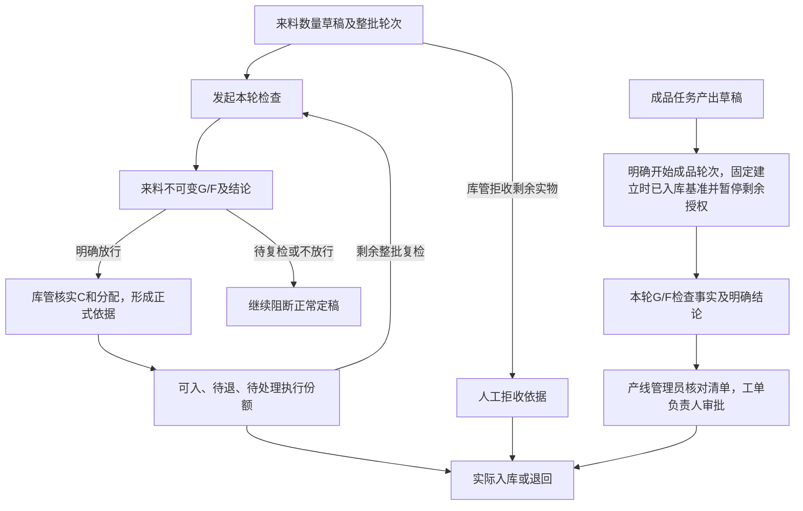

# 统一检验模型

本文维护两种来源共用检验事实时的职责对照。成品 G/F 请求及放行规则见[成品检验](finished-inspections.md)，来料数量授权见[正式清单](../../procurement/docs/receipt-acceptance.md)，字段及条件约束见[数据库](database.md)；决策理由见 [ADR-0015](../../../../../../docs/adr/0015-unified-quality-quantity-semantics.md)与取代旧成品 C/R/S 的 [ADR-0019](../../../../../../docs/adr/0019-finished-inspection-measurement-simplification.md)。

## 所有权和流转

Quality 的 case／record 两表共享检验办理与不可变G/F事实。Procurement 拥有到货、实收修订、整批处理轮次、正式清单及执行范围；Production 拥有产出草稿、审批及批准清单；Inventory 只记录真实库存。每份检查仍绑定真实来源，不因共用表而混合不同来源事实。

[来料质检分组主单](incoming-inspection-orders.md)及其关联表只组织完整到货，可跨采购、跨供应商；分组不成为检查来源，不冻结检查、合并 G/F 或改变逐到货明细的放行资格。主单没有业务办理状态，移动到货不修改下方逐来源事实链。

来料全检和抽检都判断本轮整批实物资格，样本不是独立处置份额。复检在开始前替代本批所有尚未实际处置范围，统一形成新轮；已经入库或退回的事实不变。旧记录不能重新消费，不相加历史正式清单。

来料首次、复检均有明确开始动作。Quality case 的 completed 表示检查事实已完成；来源round分别表达待复检、不放行、待核对定稿。`superseded`办理只表示未完成检查已因来源更正、拒收或整单登记作废失效，迟到提交直接拒绝，无新结果。整单作废由 Procurement 判断资格并建立终止轮，Quality 经公开命令终止各来源行全部仍在途的办理；已完成检验及其 G/F 保留，字段和事务边界见[数据库](database.md)。

## 数量授权

Production 在建立轮次时固定计划内／外历史已入基准和剩余送检范围，开始复检时暂停旧剩余授权。Quality case 绑定 `finished_round_id`，一轮一次检查；其 G/F 不测整批。

| 项目 | 来料 | 成品 |
| --- | --- | --- |
| 质检填数 | 全检/抽检 G、F，自动 N=G+F | 全检/抽检 G、F，自动 N=G+F；普通 N>0 |
| 整批 C | 库管正式清单确认 | Quality 不输入、不返回、不推算整批 C |
| 数量建议或提示 | 全检建议 G；抽检建议 C−F | Quality 不生成建议；定稿提示由 [Production](../../production/docs/database/production-termination.md#数量质检与更正) 所有，不形成 Quality 授权 |
| 差异责任 | 库管超建议需非空依据，原 G/F 不可覆盖，分配总和仍=C | 抽检不推整批、质检无产出差异；全检定稿提示不阻断，保留原说明与负责人审批 |
| 强制校验 | 定稿提示 C 与 D、全检 N 与 C 或抽检 N>C，并要求核对依据 | Quality 核验 G/F 与明确结论；产出上下限、授权与冻结由来源核验 |
| 零量 | 实收纠错，无零件检验 | `zero_confirmation` 的 G=F=N=0 且明确 `released` |

两来源共用检查事实，不共享数量授权。来料抽检、超建议依据和人工拒收见[正式清单](../../procurement/docs/receipt-acceptance.md#数量与建议)；成品复检范围、固定已入基准与非阻断定稿提示见[成品检验](finished-inspections.md)。旧检验与已执行事实均保留，不能累加历史清单恢复授权。
