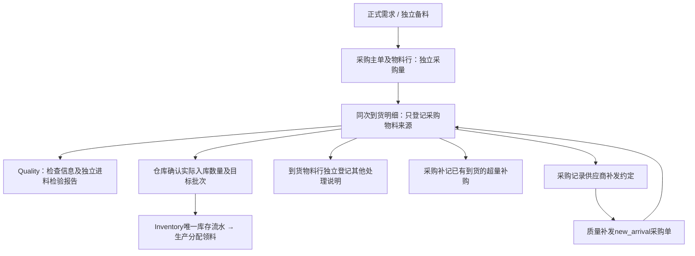

# 采购与外购物料入库设计

本文说明采购至入库的跨模块流程。单模块规则由下表所有者维护；历史选择与取代范围见[ADR 索引](README.md#adr)，未实施及待验收范围见[路线图](roadmap.md)。

## 流程

按[ADR-0028](adr/0028-independent-warehouse-receipt-and-inspection.md)，到货后检查报告、仓库收货和补单独立办理；允许先入库后登记检查。采购计划、生产需求、检查事实和实际库存分别成立，下单、到货及检查都不增加库存。仓库明确确认实际数量后由 Inventory 记账，生产随后通过分配和领料履约。

到货不填实收总量，检查数量只代表本次检查；不维护全批去向守恒或可入库授权。其他处理只记录文字去向，不追踪线下执行，不形成退回或报废库存。超量补购追溯已有到货且不重复物流；质量补发形成自己的新到货，具体来源资格见采购订单。

## 所有者

| 内容 | 唯一维护位置 |
| --- | --- |
| 采购身份、供应商、金额、补单及采购状态 | [采购订单](../apps/api/src/modules/procurement/docs/purchase-orders.md) |
| 到货来源、作废、其他处理与实际入库编排 | [到货命令](../apps/api/src/modules/procurement/docs/receipts.md) |
| 检查事实及来料／成品职责差异 | [统一检验模型](../apps/api/src/modules/quality/docs/unified-inspection-model.md) |
| 库存单据、批次和唯一账本 | [Inventory](../apps/api/src/modules/inventory/docs/database.md) |
| 列表、候选与历史查询 | [查询契约](../apps/api/src/modules/procurement/docs/receipt-queries.md) |
| 前端特有交互 | [采购与入库](../apps/admin-web/docs/procurement-inbound.md)、[来料检验](../apps/admin-web/docs/incoming-inspection-adoption.md) |

来源模块核验有效到货身份，Quality 与 Inventory 分别写自己的事实；跨模块原子性、调用方向和锁序由[库存协作协议](inventory-extraction-design.md)维护。采购结束只停止新增到货，已经登记的来源继续办理；补单不改变原到货及实际入库的归属。

范围和排除项见[产品范围](product-scope.md)，结构切换见[迁移安全](../packages/database/docs/migration-safety.md)。
