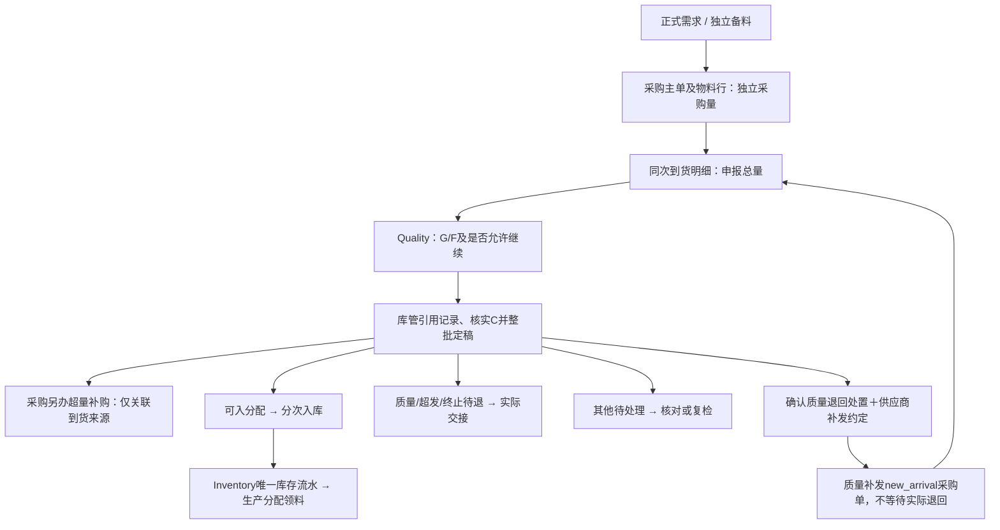

# 采购与外购物料入库设计

本文说明采购至入库的跨模块流程。单模块规则由下表所有者维护；历史选择与取代范围见[ADR 索引](README.md#adr)，未实施及待验收范围见[路线图](roadmap.md)。

## 流程

采购计划、生产需求、检验事实和实际库存分别成立：下单或到货不履约生产需求，检验放行也不直接增加库存。库管依据正式分配确认实际入库，生产随后通过分配和领料履约。

超量补购追溯原到货；质量补发形成自己的新到货。补单关系不转移原实物或仓库授权，具体来源资格见采购订单。

## 所有者

| 内容 | 唯一维护位置 |
| --- | --- |
| 采购身份、供应商、金额、补单及采购状态 | [采购订单](../apps/api/src/modules/procurement/docs/purchase-orders.md) |
| 到货、拒收、作废、实际入库与退回 | [到货命令](../apps/api/src/modules/procurement/docs/receipts.md) |
| 来料核实数量、建议、正式授权及重新办理 | [正式清单](../apps/api/src/modules/procurement/docs/receipt-acceptance.md)；[数量示例](../apps/api/src/modules/procurement/docs/receipt-round-examples.md) |
| 检查事实及来料／成品职责差异 | [统一检验模型](../apps/api/src/modules/quality/docs/unified-inspection-model.md) |
| 库存单据、批次和唯一账本 | [Inventory](../apps/api/src/modules/inventory/docs/database.md) |
| 列表、候选与历史查询 | [查询契约](../apps/api/src/modules/procurement/docs/receipt-queries.md) |
| 前端特有交互 | [采购与入库](../apps/admin-web/docs/procurement-inbound.md)、[来料检验](../apps/admin-web/docs/incoming-inspection-adoption.md) |

来源模块核验业务资格，Quality 与 Inventory 分别写自己的事实；跨模块原子性、调用方向和锁序由[库存协作协议](inventory-extraction-design.md)维护。采购结束不终止已到实物的处置，正式授权与实际执行也不因补单改变归属。

范围和排除项见[产品范围](product-scope.md)，结构切换见[迁移安全](../packages/database/docs/migration-safety.md)。
