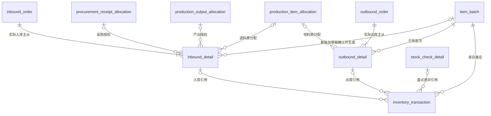

# 通用出入库数据库设计 · 获批设计备查

状态：**设计已获批并进入代码交付；用户验收和正式测试尚未完成。** 本目录保留本次完整评审依据，当前字段与规则以 [Inventory 所有者文档](../../apps/api/src/modules/inventory/docs/database.md) 为准，实际结构由版本化 migration 建立。

## 审阅入口

1. [完整字段字典](schema.md)：四张公共单据表、库存批次及流水的全部目标字段、类型、空值、默认值和用途。
2. [约束、状态和事务](constraints.md)：逐场景必填／禁止字段、键与外键、草稿、新批次、流水一致性及预留保护。
3. [全字段 SQL 展示稿](schema.sql)：与字段字典一致的六张表列定义；不是 migration，正式实施还须落实约束文件中的外键、CHECK 与触发器。
4. [设计选择与现状差异](route-comparison.md)：选定结构的理由，以及现有表的保留、改造和删除。

现行规则由 [Inventory](../../apps/api/src/modules/inventory/docs/database.md)、[Production](../../apps/api/src/modules/production/docs/database/README.md)、[Procurement](../../apps/api/src/modules/procurement/docs/database.md)及[库存协作协议](../inventory-extraction-design.md)维护；后续不要在本目录复制维护另一套现行规则。待验收及正式测试事项集中在[路线图](../roadmap.md#通用出入库后续阶段)。

## 最终结构

图中可选来源按场景互斥；六场景确认每条有效明细只产生一条原始流水，未确认没有流水。图不把既有基础冲销结构误画为一明细终生只能有一笔流水。没有退料来源关联主从；旧 `return_order/detail` 由公共入库替代。

## 六场景

| 场景 | 单据来源代码 | 入口与状态 | 来源外键 | 原始流水类型 |
| --- | --- | --- | --- | --- |
| 采购入库 | 入库 purchased | 保留业务确认成单，不提供仓库草稿编辑 | 到货／修订／检验／正式分配 | purchase_inbound |
| 批准成品入库 | 入库 finished_product | 保留批准授权后确认成单 | 产出授权；主单任务／工单／产品 | production_inbound |
| 生产退料 | 入库 return_inbound | pending → completed/cancelled，不开放编辑 | 原任务／需求／分配 | material_return_inbound |
| 其他入库 | 入库 other | 保存可编辑 pending 草稿，整单确认或取消 | 无业务来源，原因必填 | other_inbound |
| 生产领料 | 出库 production_material | pending_picking → completed/cancelled，不开放编辑 | 原任务／需求／分配 | production_material_outbound |
| 其他出库 | 出库 other | 保存可编辑 pending_picking 草稿，整单确认或取消 | 无业务来源，原因必填 | other_outbound |

一单一种场景。采购保留跨供应商合单；生产领料／退料一单一个任务，批准成品一单一个任务／产品；其他单可包含多个物料版本或成品，每行一个库存对象及目标批次。不实现部分确认或新增审批步骤。

## 本稿补齐的具体细节

- 其他单草稿可以编辑和移除行。父单 version 统一并发；行有修改及软删除审计，没有行版本或第二套草稿表。每次保存及确认保留 1–50 条有效行，空编辑表单不持久化。
- 其他入库可新建批次或沿用同身份已有可用批次。草稿只存新批次意图，确认时才建真实批次并取 IB 编号；取消不产生空批次。本期不开放人工内部批号和新批次生产日期填写。
- 其他单只办理可用批次的 available 库存。退料保留历史原批次退回资格，但不会解除其冻结／停用状态。
- 其他单既有批次按历史身份办理，可修正停用版本的存量账务；新批次只允许未删除且启用的库存对象，物料版本须启用。采购、生产领料及批准成品仍用各自用途资格。
- 其他单更正数量／批次只修正库存，不改原业务履约。两笔人工单只通过后一单备注记前一单号，不新增配对表、成对提交或批次更正模块。
- 退料不新增质检；其他入库不新增通用质检／定稿。盘点保留独立主从及现有范围。
- 流水保留一个可写来源；生成列分别建立入库／出库／盘点外键，没有第二套可写来源或数量。
- 预留仍归 Production，不新增表或缓存字段。其他出库通过明确的只读预留协作和事务保护使用未预留量。

本目录是已批准设计的评审依据，不是用户验收或正式测试通过证明。
